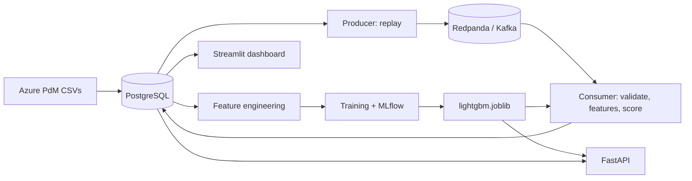

# Predictive Maintenance & IoT Sensor Analytics

End-to-end predictive maintenance pipeline on the **Microsoft Azure Predictive Maintenance dataset (simulated data)**: SQL analysis, leakage-safe feature engineering, model comparison, Kafka-based streaming scoring, a FastAPI service and a Streamlit dashboard.

> **Important:** the dataset is synthetic (generated by a simulator), so results are far cleaner than a real factory would give. "Live" data in the dashboard is a replay of historical telemetry through Kafka, not real sensors. Cost figures are assumptions.

## Problem
100 machines, hourly sensor telemetry (volt, rotate, pressure, vibration), error logs, maintenance and failure records for 2015. Goal: predict whether a machine will fail in the next 24 hours, serve the predictions, and show maintenance KPIs.

## Architecture


## Tech stack
Python, PostgreSQL, pandas, scikit-learn, LightGBM, MLflow, Redpanda (Kafka API), FastAPI, Streamlit, pytest, Docker Compose, GitHub Actions.

## Key findings (EDA, simulated data)
- comp2 is the most frequent failure (34%); model1 machines fail about 2x more per machine than model4.
- Each component has its own error signature exactly 24h before failure (comp2: error2 AND error3 in the same hour; either alone never preceded a failure).
- Sensor drift ~48h before failure is specific to comp4.
- Only ~26% of all errors precede a failure, so alerting on every error is noisy.

## Modeling
- Time-based split: train Jan-Aug, validation Sep-Oct, test Nov-Dec (24h gaps). No random split.
- 60 features, all computed from past data only. A causality test checks that cutting off the future does not change any feature.
- Class imbalance (about 2% positive rows) handled with class weights; accuracy is not used.
- Threshold 0.5 was chosen from a validation cost sweep (cost is flat from 0.05 to 0.999), not from the test set.

### Results (test set, 2 months, 114 failure events)
| Model | PR-AUC | Precision | Recall | False-alarm rows |
|---|---|---|---|---|
| Logistic Regression | 0.888 | 0.528 | 0.998 | 2,389 |
| Random Forest | 0.999 | 0.987 | 0.996 | 35 |
| LightGBM | 0.999 | 0.990 | 0.998 | 27 |
| Rule: signature in last 24h | 0.312 | 0.312 | 1.000 | 5,918 |

Event level (LightGBM vs rule baseline): both detect **114 / 114** failure events (median lead time 24h), but LightGBM raises **3** false-alarm episodes versus **239** for the rule. LightGBM and Random Forest differ by less than the noise of a 2-month test set.

Ablation: errors-only features give precision 0.35; adding sensors and maintenance features lifts it to 0.99. Machine model and age added nothing.

Assumed cost (16,000 per unplanned failure, 3,000 planned repair, 500 per false-alarm inspection): 343,500 for LightGBM vs 461,500 for the rule vs 1,824,000 with no alerts. These costs are assumptions, not dataset values.

## Streaming and API
- Producer replays telemetry into Kafka; consumer validates, scores with the same `build_features` and saved model, and writes `predictions` and `alerts` tables.
- Verified: streaming scores equal batch scores exactly (max difference 0.0 on 1,440 rows), and `/predict` matches batch within 1e-6.
- Endpoints: `GET /health`, `POST /predict`, `GET /machines/{id}/risk`, `GET /kpis` (Swagger at `/docs`).
- Throughput is low (about 2.5 messages/s); fine for hourly data from 100 machines, not a high-throughput claim.

## Screenshots
<add: Swagger /docs, dashboard live tab, dashboard test tab, Power BI report>

## Run locally
```bash
docker compose up -d                      # PostgreSQL + Redpanda
pip install -r requirements.txt
# put the 5 Kaggle CSVs in data/raw/
python src/ingestion/load_data.py
python -m src.features.build_dataset
python -m src.models.train                # creates models/lightgbm.joblib (not in repo)
python -m uvicorn src.api.main:app --port 8000
python -m streamlit run src/dashboard/app.py
python -m pytest tests -v                 # needs PostgreSQL and the trained model
```
CI runs lint and the unit tests (target, features, stream-equals-batch) only.

## Limitations
- Synthetic data with a very clean failure signature (error 24h before, sensor drift 48h before); real factories will be much harder.
- Test period is 2 months (114 events), so small metric differences are noise.
- Streaming is a replay, not real IoT sensors; costs are assumed.
- Single dataset, single train/validation/test split.